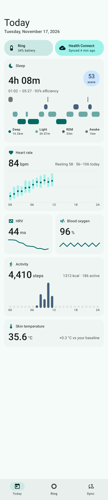
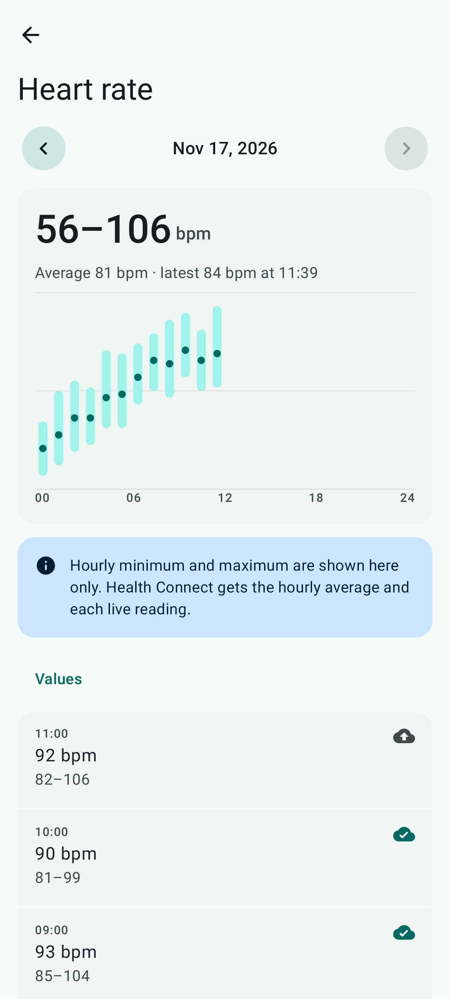
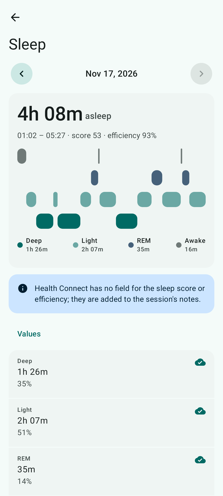
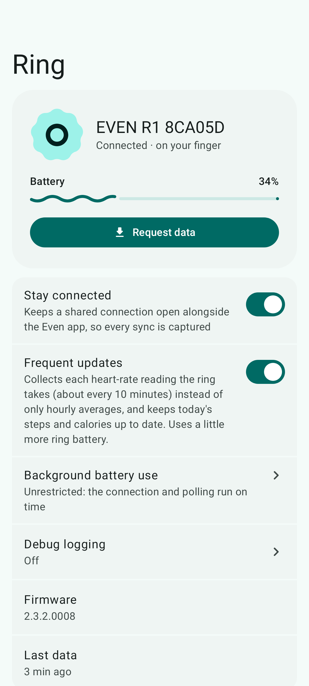
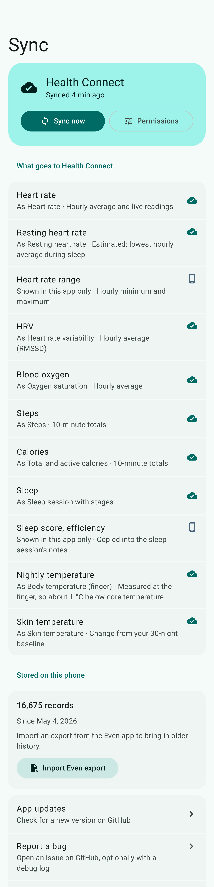
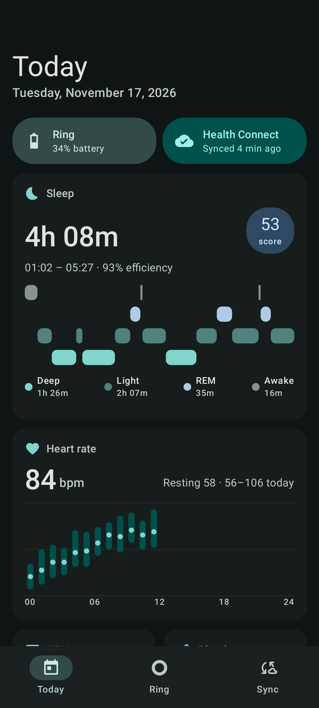

# Odd Health

An unofficial Android app that reads health data from an **Even Realities R1**
smart ring over Bluetooth, keeps it on your phone, and writes it to
**Health Connect** so other apps (Google Health, Fit and others) can use it.

> **Not a medical device.** Readings are for general wellness and personal
> interest only. They can be inaccurate, incomplete or late, and must not be
> used for medical decisions or emergencies. Read [DISCLAIMER.md](DISCLAIMER.md)
> before use.

Odd Health is an independent open-source project, not made or endorsed by
Even Realities or Google.

## What it does

- **Runs alongside the Even app.** It shares the ring's Bluetooth connection
  and only reads. It never marks data as synced on the ring, so the Even app
  keeps its full history, and it never touches the ring's pairing with your
  glasses.
- **Shows your data**: sleep with stages and the ring's sleep score, heart
  rate, resting heart rate (estimated), HRV, blood oxygen, steps, calories and
  nightly temperature, day by day, with each value marked as synced, waiting,
  or kept in the app only.
- **Writes to Health Connect**:

  | Ring data | Health Connect type |
  |---|---|
  | Hourly average heart rate, live readings | Heart rate |
  | Resting heart rate (estimated per night) | Resting heart rate |
  | Hourly HRV | Heart rate variability (RMSSD) |
  | Hourly blood oxygen | Oxygen saturation |
  | 10-minute steps | Steps |
  | 10-minute calories | Total and active calories burned |
  | Sleep with stages (score, efficiency in the notes) | Sleep session |
  | Nightly finger temperature | Body temperature (finger); skin temperature change from a 30-night baseline |

  Hourly minimum/maximum, sleep score and efficiency have no Health Connect
  type and stay in the app.
- **Imports an Even health export** to bring in older history.
- **Keeps everything on the phone.** No account, no servers, no analytics.
  The only network use is checking GitHub for app updates. See
  [PRIVACY.md](PRIVACY.md).
- **Updates itself** from GitHub releases, with optional notifications, and
  has a **Report a bug** form that can attach a debug log.

## Screenshots

  

  

On your phone the colours follow your wallpaper (Material You); the screenshots
use the fallback theme and sample data.

## Requirements

- Android 12 or later, with Health Connect (built in from Android 14).
- An Even Realities R1 ring, already paired with the phone through the Even app.

## Install

Download the APK from the [latest release](../../releases/latest) and open it on
your phone. Then follow the [user guide](docs/user-guide.md).

## Documentation

| | |
|---|---|
| [User guide](docs/user-guide.md) | Setup, everyday use, troubleshooting |
| [DISCLAIMER.md](DISCLAIMER.md) | Medical disclaimer, intended use and non-uses |
| [PRIVACY.md](PRIVACY.md) | What data is handled, where it goes |
| [Release guide](docs/release.md) | Building, signing and publishing releases |
| [CHANGELOG.md](CHANGELOG.md) | Changes by version |
| [Protocol notes](docs/protocol.md) | The ring's Bluetooth health protocol |
| [Ring and glasses](docs/ring-and-glasses.md) | How the ring, glasses and phone connect |
| [Capture guide](docs/capture-guide.md) | Capturing ring traffic for protocol work |

## Development

| Path | |
|---|---|
| `android/protocol` | Ring framing and payload decoding (pure Kotlin) |
| `android/core` | Record model, ring and Even-export ingestion, sync engine |
| `android/healthconnect` | The Health Connect sync target |
| `android/app` | Room storage, Bluetooth service, Compose UI |
| `tools/` | Python decoder and `r1tool.py` for captures and exports |
| `tests/` | Python tests |

A sync destination is a `SyncTarget` (`android/core/.../sync/Sync.kt`); adding
another health service means adding one implementation.

```sh
cd android
./gradlew :app:assembleDebug                                  # debug APK
./gradlew :protocol:test :core:test :app:testDebugUnitTest    # tests
./gradlew :app:recordRoborazziDebug                           # screenshots -> app/screenshots/
python3 -m unittest discover -s ../tests                      # Python tests
```

Needs JDK 17 or later and the Android SDK with platform 37 and build tools 36.
Debug builds are signed with the committed `android/debug.keystore` so each one
installs over the last; releases use a separate key (see the release guide).

Captures and health exports are personal data: keep them in `captures/`, which
is git-ignored.

## Credits

The ring protocol was first reverse-engineered by
[hermes-g2](https://github.com/not-benny/hermes-g2), with firmware detail from
[evenRealities-openCFW](https://github.com/kalanihelekunihi/evenRealities-openCFW).
The code here is written from their published notes.

## License

GNU General Public License v3.0; see [LICENSE](LICENSE). Provided without any
warranty.
