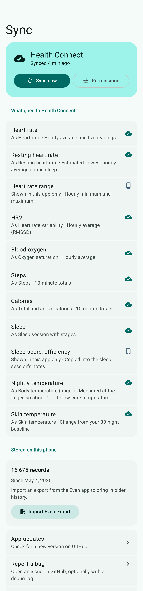
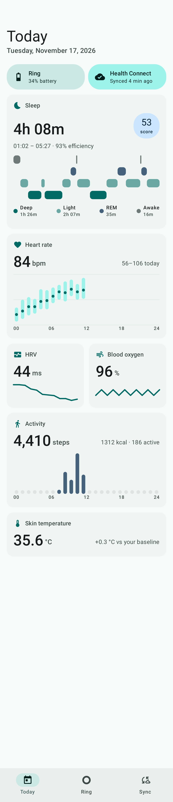
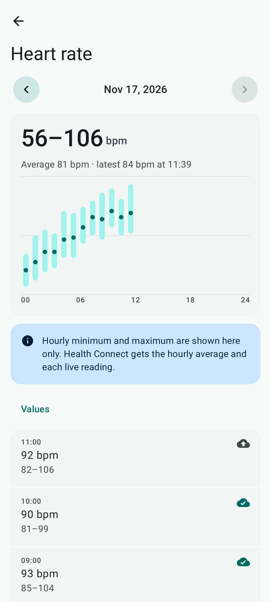
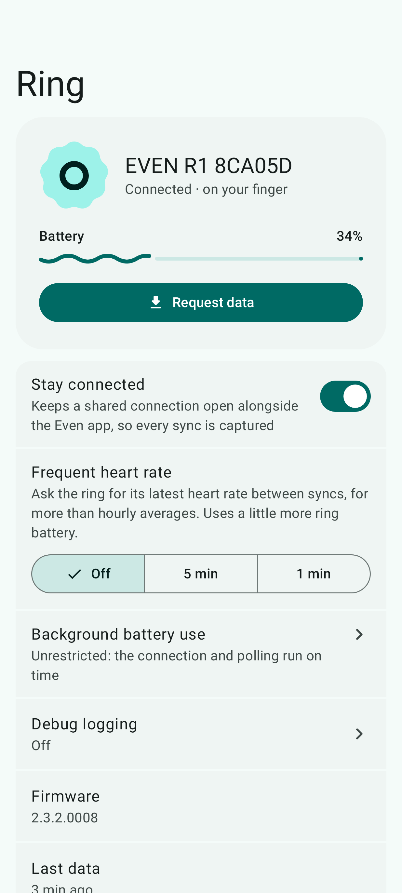
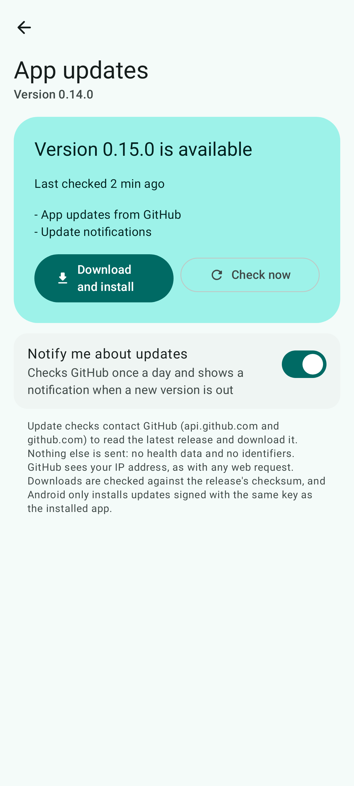
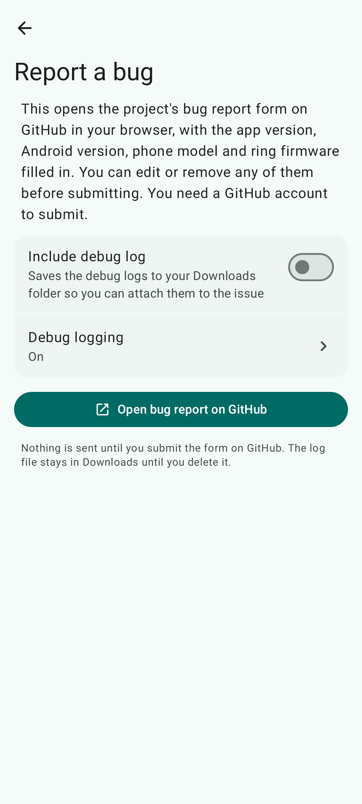
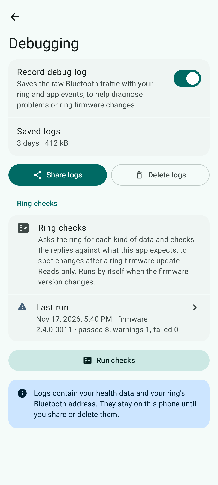

# User guide

Read the [disclaimer](../DISCLAIMER.md) first: Odd Health is not a medical
device.

## Before you start

- Android 12 or later. On Android 12 and 13, install **Health Connect** from
  the Play Store; from Android 14 it is built in.
- Your Even Realities R1 ring must already be **paired with this phone through
  the Even app**. Odd Health uses that pairing; it cannot pair a ring itself.
- Keep the Even app installed. You still need it for ring firmware updates,
  pairing, and pairing the ring with your glasses.

## Install

1. Download `odd-health-X.Y.Z.apk` from the project's latest GitHub release.
   The `.sha256` file next to it lets you check the download.
2. Open it on your phone and allow installing from that source if asked.
3. Open **Odd Health**, read the notice and tap **I understand**.
4. Allow **Nearby devices** (to reach the ring) and **Notifications** (for the
   connection notification).

**Switching from a test (debug) build:** a release can't be installed over a
debug build, because they are signed with different keys. Uninstall the debug
build first. That deletes the app's stored data; re-import an Even export
afterwards (see below). Data already in Health Connect stays there and is not
duplicated.

## Connect Health Connect

1. Open the **Sync** tab and tap **Permissions**.
2. Allow all the data types. You can leave out any you don't want; those stay
   in the app only.
3. If no permission screen appears (this can happen with apps installed from
   outside the Play Store), open Health Connect settings → App permissions →
   Odd Health, and allow it there.

The first sync starts within a minute. Other apps can take a few minutes to
show new data from Health Connect.

## Bring in your history

The ring itself only keeps a few days. For older data:

1. In the Even app, export your health data. It saves a file named
   `Even_health_data_YYYYMMDD.zip`.
2. In Odd Health, open **Sync** → **Import Even export** and pick that file.

Importing again later is safe: values that haven't changed are skipped, and
data the ring delivered after the export was made is kept.

## Everyday use

The app keeps a shared connection to the ring in the background (you'll see a
notification). Whenever the Even app syncs, Odd Health sees the same data. If
nothing arrives for 75 minutes, it asks the ring itself. New data is written to
Health Connect about 20 seconds after it arrives.

- **Pull down** on Today, Ring or Sync to ask the ring for data now and sync.

  

- **Today** shows the current day; tap a card to see that metric by day, with
  each value marked: in Health Connect, waiting to sync, or kept in this app only.
- **Ring** shows connection, battery and recent activity. **Background battery
  use** shows whether Android lets the app run freely in the background; tap it
  to allow that if it says "Optimised". It also lets you:
  - turn **Stay connected** off, which stops the background connection;
  - turn on **Frequent heart rate** (every 5 minutes or every minute) for more
    than hourly heart-rate data. It uses a little more ring battery. How much
    detail you get depends on how often the ring itself measures.
- **Sync** shows Health Connect status, what is written as which type, and how
  much is stored.

### About the numbers

- Heart rate, HRV and blood oxygen arrive as **hourly** averages; the ring does
  not store anything finer.
- **Resting heart rate** is the app's estimate: the lowest hourly average during
  your main sleep. It reads higher than a true resting rate.
- **Temperature** is measured at the finger, about 1 °C below core temperature.
  Health Connect gets it as body temperature (location: finger), and as skin
  temperature change from your own 30-night baseline once there are at least
  three earlier nights.
- **Sleep** arrives a few minutes after you wake, once the ring closes the night.
- The **sleep score and efficiency** are the ring's own; Health Connect has no
  type for them, so they are added to the sleep session's notes.

## Updates

**Sync → App updates** shows your version and checks GitHub for a newer one.
With **Notify me about updates** on (the default), the app checks once a day and
shows a notification when a new version is out.

To update, tap **Download and install**. The first time, Android asks you to
allow Odd Health to install apps; allow it, go back, and tap the button again.
Android then asks you to confirm the update. The app restarts on the new
version with your data intact.

Updates only work between release builds from GitHub. A test (debug) build
can't be updated this way; uninstall it and install the release instead.

## Troubleshooting

| Problem | Try |
|---|---|
| "No paired Even R1 ring" | Pair the ring in the Even app, then reopen Odd Health. |
| Ring shows "Not connected" | Check Bluetooth is on and the ring is charged and nearby. Toggle **Stay connected** off and on. |
| Nothing new for hours | Open the Even app once, or pull down to refresh. Check **Ring → Last data**. |
| Data in Odd Health but not in another app | Check Health Connect settings → Data and access: is Odd Health listed for that type? If it is, the other app may not read that type, or may take a while to refresh. |
| A type says "waiting to sync" | Grant that permission in **Sync → Permissions**. |
| Skin temperature says "Not supported" | Your phone's Health Connect doesn't have that type yet; body temperature is still written. |
| Even app sync seems slower | Turn off **Frequent heart rate**. Both apps share one connection. |
| Polling or the 75-minute check is late overnight | **Ring → Background battery use** → allow it. Without that, Android delays the app's timers while the phone sleeps. |
| The connection stops after a while (Samsung, Xiaomi, OnePlus, Huawei and others) | These phones add their own battery savers on top of Android's. Allow background use as above, then also exempt Odd Health in the phone's own settings: Samsung: Settings → Battery → Background usage limits → Never sleeping apps; Xiaomi: app info → Battery saver → No restrictions, and turn on Autostart. [dontkillmyapp.com](https://dontkillmyapp.com) lists the steps for each brand. |

### Reporting a problem

 

1. **Ring → Debug logging** → turn on **Record debug log**.
2. Reproduce the problem (for a sync problem, wait for or trigger a sync).
3. **Sync → Report a bug**. Turn on **Include debug log** if you want to attach
   it, then tap **Open bug report on GitHub**.
4. The app saves `odd-health-debug-logs-….zip` to your Downloads folder and
   opens the bug report form with your app, Android, phone and ring firmware
   versions filled in. Describe the problem, attach the zip from Downloads,
   and submit. You need a GitHub account.

**GitHub issues are public**, and the logs contain your health data and your
ring's Bluetooth address. If you'd rather not post them publicly, report the
problem without the log and say you have one. Alternatively, **Debug logging →
Share logs** sends the zip privately to someone you choose. Use **Delete logs**
when done, delete the copy in Downloads, and turn logging off again; it is off
by default.

## Removing the app

Uninstalling deletes everything Odd Health stored on the phone. Data it wrote
to Health Connect stays there until you delete it in Health Connect settings
(Data and access → Odd Health → Delete data; exact menu names vary by phone).
